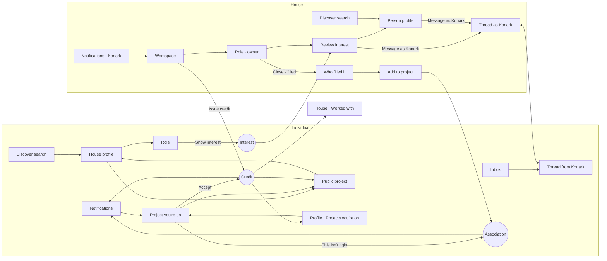

# Individual ↔ Production House bridges

An audit of every place where an Individual and a Production House meet in Ana: what one side does, which shared record it changes, and what the other side sees as a result. It covers the full lifecycle, from discovery to Interest, conversation, filling a role, being added, credit, correction, acceptance, the public record, and blocking.

**Scope and constraints.** The audit covers the Minimal direction only, with one design per screen. Research Mode's mechanics are unchanged. There are no HR or ATS features. The Figma migration is **paused**: this document only updates its inventory (section 10). Nothing in Figma was created or changed.

**Cast.** Kiran Varma (cinematographer) and Tara Menon (actor) are Individuals. Konark Pictures is a verified house. Aditi Ghosh is a person who acts for Konark.

---

## 1. Shared objects

A bridge is sound when both personas read **the same record**, and each persona gets only the actions that belong to them.

| Object | Record | Owner | Individual reads / does | House reads / does |
|---|---|---|---|---|
| House profile | `seed.orgs` + public projects + accepted credits | House | Visitor: Follow, Message, Report, Block. Sees Now making, Made by us, Worked with, Hiring. | Member acting as the house: Edit page, Open a role. A member viewing as themselves sees **Switch to Konark** instead of Follow/Message. |
| Project | `world.projects` | House (or an independent owner) | Only the public page (`work`): public title, format, stage, production, open roles, accepted credits. | The private Workspace (`hproject`). "Open in your workspace" appears only for the lead house acting as itself. |
| Role | `world.roles` + `world.roleStatus` + `world.roleEdits` | House | Show interest, Withdraw, "Updated since you showed interest", filled/closed outcome. | Review interest, Edit role, Close role, Reopen (closed only), Open a new role (filled only). |
| Interest | `world.interests` (one per person and role) | Person | Sent / Withdrawn; survives persona switches. | New, In conversation, Not now, No longer interested. Never deleted. |
| Conversation | `world.threads` (two sides: identities, not members) | Both | Reads the house as the house ("Konark Pictures · Production team"). | Reads and replies as the house ("Replying as Konark Pictures"). |
| Association ("added to project") | `world.associations` | House | "Project you're on" view: private, not a credit, "This isn't right". | Workspace "On this project": edit working role, remove, issue credit. |
| Credit | `world.credits` (prepared → proposed → accepted \| correction) | Issued by house, accepted by person | Accept, Something wrong? | Issue, prepare, reissue after correction. An accepted credit can't be removed. |
| Notification | `world.notifications` (exactly one owner: `toPersonId` or `forId`) | Recipient identity | "You" notifications only. | Filed under the house; filterable. |
| Block | `world.blocks` (by a person, of a person or house) | The person blocking | Personal, even while acting for a house. | A house never blocks; its members do, for themselves. |

**Single source of truth for credits.** Every credit surface reads `world.credits`. The older per-session "pending/accepted credits" copies in the store were removed in this pass.

| Surface | Reads |
|---|---|
| Person's profile · Credits | `publicCreditsFor(person)` (accepted, on a shared project) |
| Person's profile · Waiting for you | `world.credits` proposed or correction for the viewer |
| Project you're on | the latest credit for that association |
| Public project · Credits, "You're credited as" | `toPublicWork(project).credits` (accepted) |
| House · Worked with, "credited people" | accepted credits on the house's public projects |
| House workspace · On this project | the latest credit per association |
| Share preview ("N accepted credits") | `world.credits` for the project |

Automated check **AC-35** verifies that one record goes from issue, through a correction, to acceptance, and that the public project and the profile read that same record.

---

## 2. Bridge map

Each row is one cross-persona interaction.

| # | Triggering persona | Action | Shared object | Receiving persona | Receiving state | Resulting shared state |
|---|---|---|---|---|---|---|
| B1 | Individual | Searches "Konark" in Discover | House (search index) | – | House row → canonical house profile | None (read) |
| B2 | Individual | Opens house profile | House profile | – | Visitor: Follow, Message; Now making, Hiring, Worked with | None |
| B3 | Individual | Opens a project from the house | Project (public) | – | Public page; no working title, private roles, added people or unaccepted credits | None |
| B4 | Individual | Follows the house | Following (personal) | House: not notified | – | Personal follow list |
| B5 | Individual | Messages the house | Thread (person ↔ house, "direct") | House members acting as the house | Inbox thread from Kiran; notification "Kiran Varma messaged you", filed under Konark | One thread |
| B6 | Individual | Shows interest in a role | Interest | House | Notification "Tara Menon is interested in Supporting · Journalist on Neela Akasham"; Review shows her as New | Interest (new) |
| B7 | Individual | Withdraws interest | Interest | House | Review keeps her under "No longer interested" | Interest (withdrawn) |
| B8 | House | Reviews: Message as Konark | Thread + Interest | Individual | Inbox: thread from Konark Pictures; notification "Konark Pictures messaged you about …"; role page shows "In conversation · Open chat" | Thread; Interest (messaged) |
| B9 | House | Reviews: Not now / Move back | Interest | Individual: not told | – | Interest (not now) |
| B10 | House | Edits a role's location or dates | Role edits | Individual who showed interest | Role page: "Updated since you showed interest: location" | Role edits (shared) |
| B11 | House | Closes role as filled, chooses Tara | Role status + Interest | Everyone else interested | Notification "Konark Pictures filled … on Neela Akasham. Thanks for your interest." (public name) | Role filled; others notified |
| B12 | House | Adds the chosen person to the project | Association | Individual | Notification "Konark Pictures added you to Neela Akasham as …" → Project you're on | Association (added) |
| B13 | Individual | "This isn't right" | Association | House | Notification; workspace row "Says this isn't right" | Association (flagged) |
| B14 | House | Edits the working role | Association | Individual | Project you're on shows the new role | Association (added) |
| B15 | House | Issues a credit ("Anjali (Sister)") | Credit | Individual | Notification → Project you're on, "Waiting for you" with Accept / Something wrong? Also on Profile. | Credit (proposed) |
| B16 | House, no credit authority | Prepares a credit | Credit | Individual: nothing | – | Credit (prepared), private to the house |
| B17 | Individual | Something wrong? (reason) | Credit | House | Notification "… asked to correct a credit on …"; workspace "Correction asked · Asked: Wrong role" | Credit (correction) |
| B18 | House | Issues the corrected credit | Credit (replaces the unaccepted one) | Individual | Notification "issued you a corrected credit"; Waiting for you | Credit (proposed), still one record |
| B19 | Individual | Accepts | Credit | House + everyone | House notification "accepted the credit"; public project, profile and Worked with update | Credit (accepted) |
| B20 | House | Shares a private project | Project | Everyone; credited people | Share preview first; then the public page appears, and accepted credits move from "Projects you're on" to Credits | Project (shared) |
| B21 | House | Removes someone | Association | Individual | Project you're on: "Konark Pictures removed this association" (an accepted credit is locked and can't be removed) | Association (removed); unaccepted credit dropped |
| B22 | House | Searches people, opens Kiran | Person profile | – | The same professional profile as anyone sees, with "Message as Konark Pictures". No applicant, stage or rating fields. | None |
| B23 | House | Messages from a profile | Thread (house ↔ person, "direct") | Individual | Inbox thread from Konark Pictures; notification | One thread |
| B24 | Individual | Blocks the house | Block | House members acting as Konark | Thread: "You can't reply"; person's profile looks private; Interest refused | Block; records unchanged |
| B25 | Individual | Reports the house | Report (moderation) | Moderators | – | Report (not a record change) |
| B26 | House | Adds someone not on Ana | Association (pending) | Nobody yet | – | Private placeholder; see section 7 |

---

## 3. Flow map

Every arrow was checked for its source screen, action, transition, receiving state and persistent record. "✓" means it was exercised in a browser walkthrough (W) or an automated check (AC).

| Arrow | Source screen → action | Transition | Receiving state | Persistent | Verified |
|---|---|---|---|---|---|
| Search → House profile | Discover result row | push `org` | Visitor actions | – | ✓ W1 |
| House profile → Public project | Now making card | push `work` | Public page only | – | ✓ W1 |
| Public project → back | Back | pop | House profile, same scroll context | – | ✓ W1 |
| House profile → Role | Hiring row | push `opportunity` | Show interest | – | ✓ W1 |
| Role → Interest | Show interest → Send | sheet → toast | "Interest sent" / "In conversation" | Interest | ✓ W1, W3, AC-32 |
| Interest → House notification | – | notification (Konark) | Workspace | Notification | ✓ W1, W3 |
| House notification → Workspace | tap | push `hproject` | Workspace as Konark; if viewing as self, "Switch to Konark" link | – | ✓ W3 |
| Review → Person profile | tap person | sheet closes, push `profile` | Same profile, "Message as Konark Pictures" | – | ✓ W3 |
| Review → Thread | Message as Konark | push `conversation` | "Replying as Konark Pictures" | Thread + Interest messaged | ✓ W3, AC-31 |
| Thread ↔ Thread | send | shared record | Person sees Konark Pictures; notification on first message | Thread | ✓ W2, W3 |
| Role → Close as filled → Who | Close role → Filled through Ana → Continue | sheet steps | Everyone still interested, messaged included | Role status | ✓ W3 |
| Who → Add to project | pick Tara | Add person sheet, prefilled | "It isn't their credit" | Association | ✓ W3 |
| Add → Individual notification | – | notification (Tara) | Project you're on | Notification | ✓ W3 |
| Profile → Project you're on | Projects you're on row | push `association` | Same view | – | ✓ W3 |
| Project you're on → This isn't right | confirm | inline | "You told Konark…" | Association flagged | ✓ W3 |
| Workspace → Issue credit | person row → Issue credit | sheet | Preview of the public line | Credit proposed | ✓ W4, W5 |
| Credit → Individual notification | tap | push `association` | Waiting for you | – | ✓ W4, AC-35 |
| Project you're on → Accept | Accept | toast; view updates | "Your credit is public" / "public when shared" | Credit accepted | ✓ W4, W5 |
| Accepted → Public project, Profile, Worked with | – | derived | Updated on every surface | – | ✓ W4, AC-35 |
| Something wrong? → House | reason → Send | toast | "Correction sent" | Credit correction | ✓ W5 |
| House → corrected credit → Individual | Issue corrected credit | notification | Waiting for you | Credit proposed (one record) | ✓ W5, AC-35 |
| Role edit → person | Edit role → Save | shared record | "Updated since you showed interest" | Role edits | ✓ Extra |
| Share → public | Share on Ana → preview → Share | toast | Public page; credit moves to Credits | Project shared | ✓ W5 |
| Block | More → Block | sheet | Blocked states on both sides | Block | ✓ W6, AC-34 |
| House search → Kiran → Message | Discover → profile → Message as Konark | push | Thread as Konark | Thread | ✓ W2 |

**Reverse discovery loop.** A person finds a house through search, a byline on a role, a credit on their own or someone else's profile, or a public project. A house finds a person through search, Interest, a public project's credits, or its own Worked with. Both loops end on the canonical profile of the other side. No surface exists only for one direction.

---

## 4. Bridge screens, classified

**Existing and complete (no change needed)**
- House profile (OrgScreen): the canonical page, with visitor and member modes.
- Public project (WorkScreen), including "You're credited as".
- Role page, owner view: Review, Edit role, Close role.
- Workspace: On this project, Issue credit, Person actions.
- Share on Ana preview (says what becomes public and what stays private).
- Person profile as seen by a house: no ATS fields.

**Existing but incomplete (completed in this pass)**
- **Project you're on** (`association`): now has a "Where this stands" block (on the project / credit / public). It shows Waiting for you with Accept and Something wrong? in place, a correction note, the accepted states (public, or public when shared), a link to the house, and a guard so only the person it is about can open it. "This isn't right" shows only before a credit exists; after that, "Something wrong?" is the single way to correct.
- **Profile · Projects you're on**: now keeps every association visible until its credit is public, with a stage line (Added · not a credit / Credit waiting for you / Correction sent / Credit accepted · public when the project is shared). Previously a proposed credit made the project vanish from this list.
- **Review interest** (sheet): now shows New, In conversation (with Open chat), Not now (with Move back) and No longer interested. Messaging someone used to delete their Interest from the review and from the "who filled it" list.
- **Conversation**: now a shared thread. A blocked state keeps the history and closes sending. The header opens the house page for a house.
- **Role page, individual**: when the person was chosen and added from a filled role, it shows "Konark Pictures added you to the project for this role · See project".
- **House profile, member viewing as themselves**: shows "Switch to Konark Pictures" instead of Follow/Message.
- **Workspace, member viewing as themselves**: the note now has a Switch link.

**Missing and required (added)**
- No new screen was needed. Every missing bridge was a missing **state** or **record** on an existing canonical screen. This matches the "one product, many states" rule.

**Not actually needed**
- A separate "house view of a person" screen: the canonical profile serves both personas.
- "Add to project" from a person's profile: adding happens in the workspace, where the project context lives.
- A "Bridges" page in Figma: states go onto pages 03, 04 and 05 (section 10).
- Telling the person about "Not now": kept silent by design.
- House-side "followers" list: following is personal.

---

## 5. Project you're on (Individual)

Reached from **Profile → Projects you're on** or from the "added you" and "issued you a credit" notifications.

It shows only what this person is authorised to see:
- the working title (they were told it when added);
- format, languages and stage;
- the house, which opens its profile;
- their own working role;
- where things stand: on the project, credit, public;
- a note that being added isn't a credit;
- their own credit line when one is issued, with Accept and Something wrong?;
- their own correction note;
- "This isn't right", before any credit.

It never shows:
- other people on the project;
- other roles, including private ones;
- anyone else's credits;
- prepared (unissued) credits;
- the house's notes;
- interest counts;
- the public title before it is shared.

Covered by W3: the view is checked against Ishaan, Lakshmi, Sana, Amma, Production Designer, 1st AC, Colourist, Gaffer and Dev, and none of them appear.

**Added is never a credit.** The sequence is continuous and every step is a state of the same screen:

1. **Added:** "Konark Pictures added you as Journalist". Credit: Not issued. Public: No.
2. **Credit issued:** "Waiting for you: Anjali (Sister)" with Accept / Something wrong?
3. **Correction:** "You asked: Wrong role. Konark will send a corrected credit."
4. **Accepted, project private:** "Credit accepted. It becomes public when Konark Pictures shares the project."
5. **Accepted, project public:** "Your credit is public" with View public project. The row leaves Projects you're on and appears under Credits on the profile, on the public project, and in Konark's Worked with.

---

## 6. Notifications audit

| Event | Recipient identity | Text (example) | Opens | Identity switch? | Private data? |
|---|---|---|---|---|---|
| Interest sent | Konark (house) | Tara Menon is interested in Supporting · Journalist on Neela Akasham | Workspace | No; a member viewing as themselves gets a Switch link | Public role name |
| First message from a side | The other identity | Konark Pictures messaged you about Supporting · Journalist | Thread | No | None; the member is never named |
| Role filled or closed | Each other interested person | Konark Pictures filled … on Neela Akasham. Thanks for your interest. | Role | No | Public name only (AC-33) |
| Added to project | Person | Konark Pictures added you to Neela Akasham as Journalist | Project you're on | No | Working title, which the added person may see |
| "This isn't right" | Konark | Tara Menon says being on … isn't right | Workspace | No | – |
| Credit issued / corrected | Person | Konark Pictures issued you a (corrected) credit on …: Anjali (Sister) | Project you're on | No | Only their own line |
| Correction asked | Konark | Tara Menon asked to correct a credit on …: Wrong role | Workspace | No | – |
| Credit accepted | Konark | Tara Menon accepted the credit on …: Anjali (Sister) | Workspace | No | – |

Every notification has exactly one owner (AC-28). A member only receives the notifications of houses they currently belong to (AC-27). Opening a notification never changes who you are acting as. An action that needs another identity always asks for an explicit switch.

---

## 7. Transitions acknowledged, not built

**Not on Ana → real account.** A house can add someone privately by name and phone. That creates no profile, no search entry and no credit.

Intended rule:
1. When that person joins with the same verified phone number, the placeholder becomes their association.
2. They get the "added you" notification.
3. Credits become possible from that point.

The claim step is not built. It needs a rule for conflicts: the name differs, or two houses used the same number.

**Private → public project.** Built and walked through (W5, B20). Sharing reveals only what the preview lists. Accepted credits on a private project stay under Projects you're on until the project is shared.

---

## 8. Blocking and reporting

- A block is made **by a person** and targets a person or a house. It stays personal even while that person acts for a house.
- A block closes contact **both ways** between the two identities:
  - no new messages;
  - Interest is refused;
  - the blocked identity sees the profile as private and is never told why.
- It **never erases shared history**. Thread messages, credits, associations, Interest and public projects are unchanged (W6, AC-29, AC-34). The person who blocked sees "You blocked Konark Pictures. Messages stay here."
- Reporting creates a moderation report and changes no records.

---

## 9. Contradictions found and gaps

**Contradictory rules (resolved in this pass)**
1. **Close role and notifications.** The Close role sheet promised "everyone else who showed interest is told", but nobody was notified. They now are, by public name.
2. **Messaging and the Interest record.** "Message" in the review deleted the person's Interest, which contradicted "nobody silently vanishes". It also removed them from the "who filled it" list, which broke fill → add.
3. **What a block promised.** The Block sheet promised "They can't message you or show interest". In practice a block was one-way UI state, and it even carried over when switching persona.
4. **Two copies of one conversation.** The Kiran ↔ Konark conversation existed as two separate copies, one of them signed "Aditi Ghosh · Konark Pictures". It is now one thread, and its identity is Konark.
5. **Interest state lost on persona switch.** A person's sent Interest was forgotten after switching persona, while the house still had it.
6. **Credit notification destination.** Credit notifications opened the Profile rather than the project the credit is on.
7. **Proposed credits hidden from the list.** A proposed credit hid the project from Projects you're on, which broke the added → credit continuity.
8. **Unguarded Project you're on.** Anyone holding the route could open a person's Project you're on.
9. **Role edits stayed local.** A house's edits to a role were local to that session, so "Updated since you showed interest" never reached the person.

**Behaviour-only gaps (still open; a rule is needed before UI)**
- **Correcting an accepted credit.** "Something wrong?" on the public project says "Sent to the production", but no record is created. Needs a rule: does a correction unpublish, or stay public until reissued?
- **Blocking a member, not the house.** If Tara blocks Aditi personally, Aditi can still write to her *as Konark*. Blocks target identities; a rule is needed on whether blocking a member also blocks the houses they act for.
- **Roles from blocked houses in Discover.** They still appear (AC-12, an existing P0 failure, left for the P0 fix pass).
- **Losing access to a house.** House threads leave a member's inbox when their membership ends, but the console has no control to end a membership.
- **Not on Ana → real account.** The claim step (section 7).

**Private data confirmation.** Walkthroughs W1–W6 checked each receiving screen for data it must not show:
- the working title, on public surfaces;
- private roles;
- other people on a project;
- unaccepted credits;
- the member's name on house messages;
- whether someone was blocked.

None leaked. AC-01 to AC-10 (existing) and AC-31 to AC-35 (new) assert the same rules on the records.

---

## 10. Figma migration inventory: bridge additions

The migration stays **paused**. When it resumes, it continues from where it stopped (page 03, section "Flow B"; IND-01 and PRF-01 are done). The following frames join the existing inventory on their persona's pages. Nothing goes on a separate page. IDs are assigned in sequence when each frame is built.

**03 · Individual**
- Project you're on / Added (not a credit)
- Project you're on / Credit waiting for you
- Project you're on / Correction sent
- Project you're on / Accepted, project private
- Project you're on / Accepted, public
- Project you're on / You said this isn't right
- Project you're on / Removed
- Profile / Own / Projects you're on (with stage lines)
- Role / Filled, you were added
- Role / Updated since you showed interest
- Conversation / From a house (Konark Pictures · Production team)
- Conversation / You blocked them (history kept)
- House profile / Blocked by you

**04 · Production House**
- Review interest / New, In conversation, Not now, No longer interested
- Close role / Who filled it (includes people in conversation)
- Add person / Prefilled from a filled role
- Workspace / Person flagged "isn't right"
- Workspace / Correction asked → Issue corrected credit
- Workspace / Viewing as yourself, with Switch link
- House profile / Member viewing as themselves (Switch to house)
- Conversation / Replying as the house
- Conversation / Can't reply (blocked by the person)
- Person profile / Seen by a house (Message as house; no ATS)
- Person profile / Unavailable (looks private)

**05 · Projects, Roles & Credits**
- Credit lifecycle strip: Added → Proposed → Correction → Reissued → Accepted (private) → Accepted (public)
- Public project / Credits after acceptance ("You're credited as")
- Notifications / Bridge set (interest, message, filled, added, credit issued, corrected, correction asked, accepted)

---

## 11. Walkthroughs

Run in Chromium against the prototype. Personas were switched through the console, so the shared records carry over exactly as they would between two phones.

| # | Walkthrough | Steps | Result |
|---|---|---|---|
| W1 | Kiran → Search → Konark → house profile → project → back → role → Interest; Konark is notified | 8 | Pass |
| W2 | Konark → search → Kiran profile → Message as Konark; Kiran is notified and reads it from Konark Pictures | 4 | Pass |
| W3 | Tara Interest → Konark review → Tara profile → Message → fill → add Tara → Tara notification → Project you're on → This isn't right | 17 | Pass |
| W4 | Konark corrects the role, issues "Anjali (Sister)" → Tara accepts from the notification → public project, profile, Konark Worked with, notifications | 10 | Pass |
| W5 | Correction loop on a private project (Kiran, Kaal) → corrected reissue → accept → share → public | 14 | Pass |
| W6 | Tara blocks Konark: credit, public project and thread history remain; both sides are closed for sending; Konark sees a private profile | 7 | Pass |
| Extra | Interest survives a persona switch; withdraw → "No longer interested"; a house's role edit reaches the person ("Updated since you showed interest: location"); Research Mode, Lab and scenario links load | 6 | Pass |
