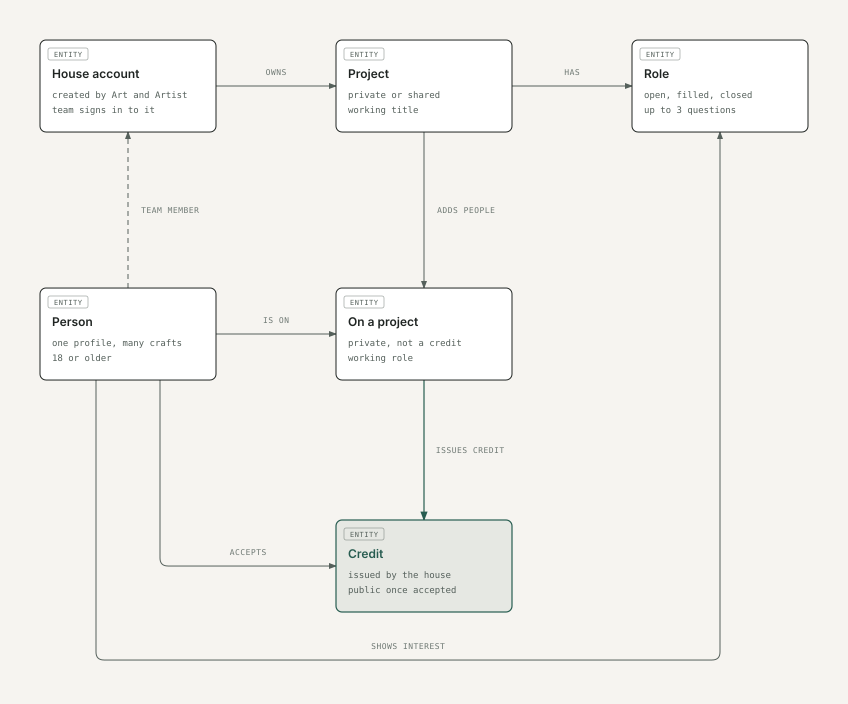

# 1. People, relationships and permissions

For approval on Sunday. Describes the prototype as it is today.

## Personas

| Persona | Who they are | What they want from Ana | In the prototype |
|---|---|---|---|
| **Established professional** | A working crew member with real credits, such as a cinematographer | Be found for the right work, show a credible record, hear about paid work nearby before it closes | Kiran Varma, cinematographer |
| **Early-career professional** | An actor or crew member with little or no verified work yet | Get noticed, find first opportunities, build a record | Tara Menon, actor, early career |
| **New person** | Someone arriving for the first time | Understand what Ana is, sign up quickly, see value on the first Home | New person flow (Studio) |
| **Production house** | The company: its public page, projects, roles and authority to issue credits. Brought on by Art and Artist's sales team | A trusted public page, hiring, credible credits for its films | Konark Pictures (busy), Tidewater Films (smaller) |
| **House team member** | Someone at the house, such as a line producer, who signs in to the house account and uses it | Publish roles, find and contact people, run a project's team and credits | Aditi (in the prototype she reaches Konark by switching; the live app signs in to the house account directly) |
| **Art and Artist team** | Sales, who bring houses on and create their accounts; moderators, who handle reports. Internal tools, never app personas | Onboard houses correctly; handle reports fairly and quickly | Moderation console (the account-creation tool isn't built) |

## Account types

| Account | How it's created | Who uses it |
|---|---|---|
| **Personal account** | The individual signs up (Apple, Google or email) | That one person. Every person has exactly one account and one professional profile |
| **House account** | Created internally by Art and Artist's team after the sales visit. Houses can't sign up themselves | The house's team member(s) who sign in to it (how many is open, brief item B9) |
| **Art and Artist staff** | Internal | Sales (create house accounts), moderators (console). Moderators can't delete credits |

Personal accounts and house accounts are separate. Nobody switches between a personal profile and a house in the live product. Whether a house team member may also have a personal account is open (brief item B10).

## How they relate

Rules visible in the diagram:

- A credit only ever starts at a house account. A person can accept it or say "Something's wrong", never create, claim or request one.
- Being added to a project (an association) is private and is not a credit.
- Follow, Save, Report and Block belong to the account that does them.
- A person messaging a house talks to the house account; replies come from the house.

## Who can do what

| Action | Personal account | House account | Art and Artist team |
|---|---|---|---|
| Sign up | Yes | No: created by Art and Artist | Creates house accounts |
| Edit profile or house page, post | Yes (own profile) | Yes (house page, posts as the house) | No |
| Open to work, show interest in a role | Yes | No | No |
| Accept or correct a credit | Yes (own credits) | No | No |
| Follow, save, report, block | Yes | Yes, as the house | No |
| Create private projects | Independent projects only (credits not verified yet) | Yes | No |
| Publish a public role, share a project, appear in search | No | Yes, once verified | Verifies houses |
| Review interest, message people | Message people | Yes | No |
| Add people to a project, issue credits | No | Yes, once verified (who inside the house may issue is brief item B1) | No |
| Handle reports: dismiss, warn, remove, restrict, suspend, escalate | No | No | Moderators (restrict and suspend are high impact) |
| Delete a credit | Nobody | Nobody | Nobody |

**In the prototype:** house actions are shown by Aditi switching into Konark Pictures, and the house settings list members, "who can act for this house" and "stop acting for the house". Those follow the switching model and will be replaced by the house-account model above.

**For approval:** the personas, the account types, the relationships, and this permission table. Brief items B1, B9, B10 and B11 fill in the open details.
