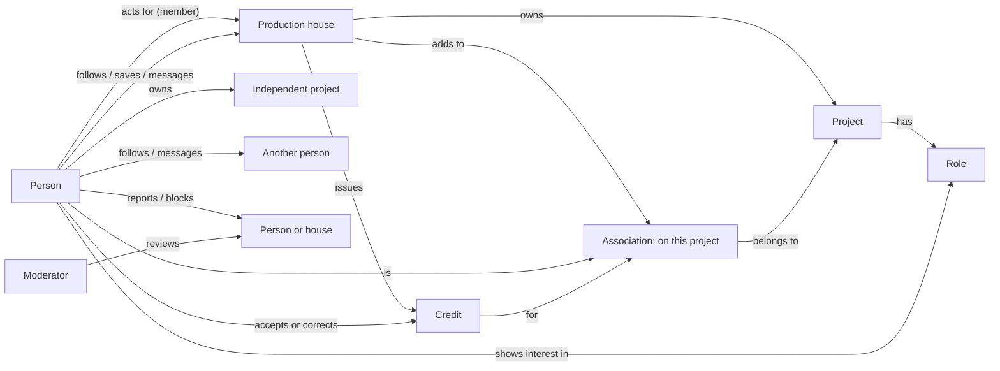

# 1. People, relationships and permissions

For approval on Sunday. Describes the prototype as it is today.

## Personas

| Persona | Who they are | What they want from Ana | In the prototype |
|---|---|---|---|
| **Established professional** | A working crew member with real credits, such as a cinematographer | Be found for the right work, show a credible record, hear about paid work nearby before it closes | Kiran Varma, cinematographer |
| **Early-career professional** | An actor or crew member with little or no verified work yet | Get noticed, find first opportunities, build a record | Tara Menon, actor, early career |
| **New person** | Someone arriving for the first time | Understand what Ana is, sign up quickly, see value on the first Home | New person flow (Studio) |
| **House member** | Someone who works at a production house and acts for it, such as a line producer | Publish roles, find and contact people, run a project's team and credits, without mixing in their personal account | Aditi, acting for Konark Pictures |
| **Production house** | The company itself: its public identity, projects and authority to issue credits | A trusted public page, hiring, credible credits for its films | Konark Pictures (busy), Tidewater Films (smaller) |
| **Ana moderator** | Ana staff, working in an internal console, never an app persona | Handle reports and verification fairly and quickly | Moderation console |

One person can be several of these at once. Aditi has her own professional profile and also acts for Konark. A person is never "an employee of" one house: profiles belong to people.

## Account types and roles

| Account or role | What it is |
|---|---|
| **Person** | Every human has exactly one account and one professional profile |
| **House** | An organisation with its own public page. It is not a login; people act for it |
| **House owner** | A person who controls the house: members, page, verification |
| **House member** | A person allowed to act for the house |
| **Member who can issue credits** | A member the owner has given credit authority. Others can only prepare credits |
| **Moderator** | Ana staff in the internal console. Cannot delete credits |

## How they relate

Rules visible in the diagram:

- A credit only ever starts at a house. A person can accept it or say "Something's wrong", never create, claim or request one.
- Being added to a project (an association) is private and is not a credit.
- Follow, Save, Report and Block are always personal, even while acting for a house. A house never blocks; its members do, for themselves.
- Messages between a person and a house are between identities: the person sees "Konark Pictures", members reply "as Konark Pictures".

## Who can do what

| Action | Person | House member (no credit authority) | Member who can issue credits | House owner | Moderator |
|---|---|---|---|---|---|
| Edit own profile, post, Open to work | Yes | Yes (as themselves) | Yes (as themselves) | Yes (as themselves) | No |
| Show interest in a role | Yes | Only as themselves | Only as themselves | Only as themselves | No |
| Accept or correct own credit | Yes | Only as themselves | Only as themselves | Only as themselves | No |
| Follow, save, report, block | Yes | Always personal | Always personal | Always personal | No |
| Create a private project for the house | No | Yes | Yes | Yes | No |
| Publish a public role | No | Yes, if the house is verified | Yes, if verified | Yes, if verified | No |
| Review interest, message as the house | No | Yes | Yes | Yes | No |
| Add people to a project | No | Yes | Yes | Yes | No |
| Prepare a credit | No | Yes | Yes | Yes | No |
| Issue a credit | No | No | Yes, if verified | Yes, if verified | No |
| Share a project publicly | No | Yes, if verified | Yes, if verified | Yes, if verified | No |
| Manage members and the house page | No | No | No | Yes (the owner's screens aren't built yet) | No |
| Stop acting for the house | No | Yes | Yes | No | No |
| Start an independent project | Yes (its credits show as not verified yet) | As themselves | As themselves | As themselves | No |
| Handle reports: dismiss, warn, remove, restrict, suspend, escalate | No | No | No | No | Yes (restrict and suspend are marked high impact) |
| Delete a credit | Nobody | Nobody | Nobody | Nobody | Nobody |

**Unverified house:** can create its page, private projects and invite members, but can't publish public roles, issue credits, share projects or appear in search.

**For approval:** the persona list, the relationships, and this permission table. Open item B1 in the brief (who inside a house issues credits) changes the "Member who can issue credits" column.
