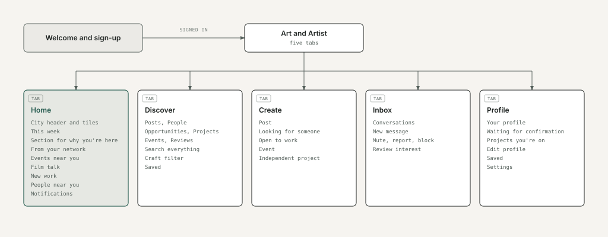
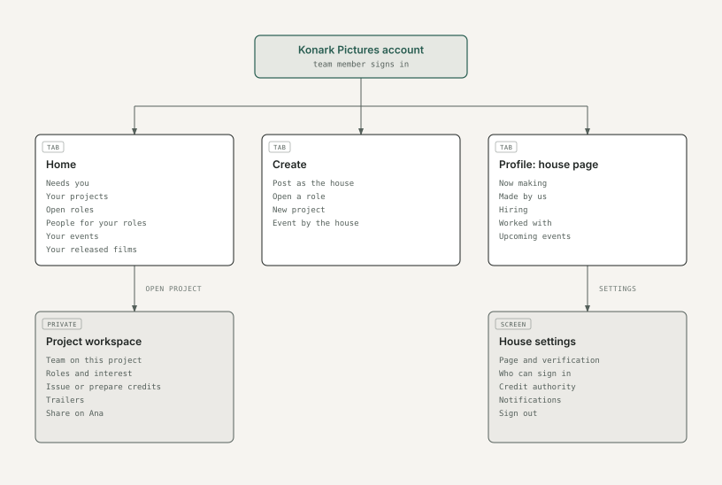

# 2. Information architecture

Every screen in the prototype and how you get to it. A personal account and a house account each have five tabs; Home, Create and Profile hold different things for a house.

## As a person

## Shared detail screens

Reachable from Home, Discover, search, notifications, messages and profiles.

- **From any card or link:** person profile, house page, project page (trailer, credits, open roles), role page, event page, post or video viewer, film reviews.
- **From a role page:** Show interest. **From a person's profile:** Message, Report, Block.

## A house account

A house team member signs in to the house account, which Art and Artist's team created. Its Home, Create and Profile differ from a person's; Discover and Inbox work the same way.

In the prototype you reach the house by switching from Aditi's profile. The live app has no switch: the house account is signed in to directly.

## Sheets (open over the current screen)

Show interest · Review interest · Open a role (pick project) · New project · Edit role · Close role · Availability · Share · Report · Report a credit · Block · Write a review · Notifications · Post options.

**For approval:** the five-tab structure, what each tab holds for a person and for a house account.
