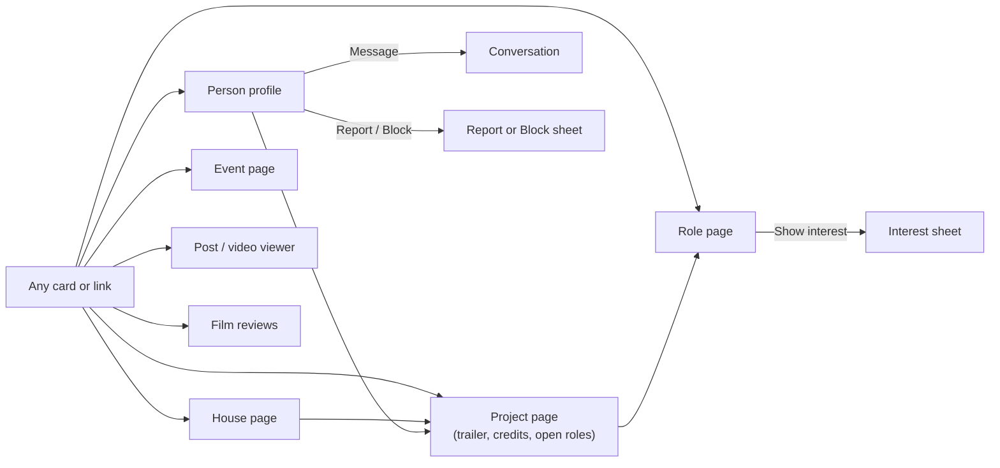
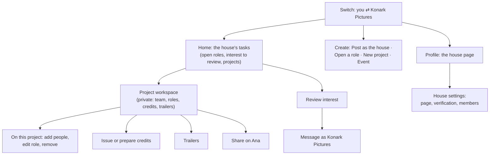

# 2. Information architecture

Every screen in the prototype and how you get to it. The app has five tabs; what Home, Create and Profile show depends on who you are acting as.

## As a person

```mermaid
flowchart LR
  Entry["Welcome<br/>intro, sign in,<br/>sign up, onboarding"] --> HOME
  subgraph HOME["Home"]
    direction TB
    h1["Tiles: Events, Projects,<br/>People, Opportunities, Reviews"] ~~~ h2["This week"] ~~~ h3["Opportunities for you"] ~~~ h4["New work"] ~~~ h5["People near you"] ~~~ h6["Notifications"]
  end
  subgraph DISC["Discover"]
    direction TB
    d1["Posts · People ·<br/>Opportunities · Projects ·<br/>Events · Reviews"] ~~~ d2["Search everything"] ~~~ d3["Saved"]
  end
  subgraph CREATE["Create"]
    direction TB
    c1["Post"] ~~~ c2["Looking for someone"] ~~~ c3["Open to work"] ~~~ c4["Event"] ~~~ c5["Start an independent project"]
  end
  subgraph INBOX["Inbox"]
    direction TB
    i0["You · each house · All<br/>(house members only)"] ~~~ i1["Conversations"] ~~~ i2["New message"] ~~~ i3["Conversation options:<br/>mute, report, block"]
  end
  subgraph PROF["Profile"]
    direction TB
    p1["Edit profile (sections)"] ~~~ p2["Credits · Waiting for you"] ~~~ p3["Saved"] ~~~ p4["Settings"] ~~~ p5["Your data"] ~~~ p6["Terms and privacy"]
  end
  HOME -- "tiles and See all" --> DISC
  HOME ~~~ CREATE ~~~ INBOX ~~~ PROF
```

## Shared detail screens

Reachable from Home, Discover, search, notifications, messages and profiles.

## Acting for a house

Switching identity (tap your avatar, or "Switch to Konark") changes three tabs.

## Sheets (open over the current screen)

Show interest · Review interest · Open a role (pick project) · New project · Edit role · Close role · Availability · Share · Report · Report a credit · Block · Switch identity · Write a review · Notifications · Post options.

**For approval:** the five-tab structure, what each tab holds, and how acting for a house changes Home, Create and Profile.
