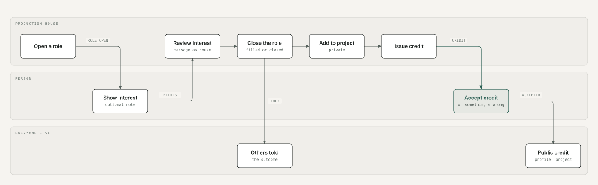

# 3. Connection map: how people's journeys hand off to each other

Ana is a two-sided product. Most journeys start with one person and finish with another. This map shows the full chain from a house needing someone to that person's profile showing a verified credit, and every point where it can branch.

The main chain only. Branches (withdrawing, corrections, removing someone, amending an accepted credit) are in the table below.

## Every hand-off, and what the other side sees

| # | Who acts | Action | Who is affected | What they see |
|---|---|---|---|---|
| 1 | Person | Shows interest in a role | House | Notification; person appears as "New" in Review |
| 2 | Person | Withdraws interest | House | Person stays in the list, greyed, "No longer interested". No notification |
| 3 | House | Messages as the house | Person | Conversation from Konark Pictures; role page says "In conversation" |
| 4 | House | Marks "Not now" | Person | Nothing (not told) |
| 5 | House | Changes a role's location or dates | People who showed interest | "Updated since you showed interest: dates" |
| 6 | House | Closes a role (filled or closed) | Everyone else interested | "Konark Pictures filled (or closed) this role. Thanks for your interest." |
| 7 | House | Adds someone to a project | Person | Notification; private "Project you're on" (not a credit) |
| 8 | Person | "This isn't right" | House | Workspace shows the flag |
| 9 | House | Issues a credit | Person | "Waiting for you" with Accept or Something's wrong |
| 10 | House (no credit authority) | Prepares a credit | Nobody yet | Held privately until someone with authority issues it |
| 11 | Person | Something's wrong (reason) | House | "Correction asked" with the reason |
| 12 | House | Issues the corrected credit | Person | Waiting for you again; still one record |
| 13 | Person | Accepts | House and everyone | Credit appears on the profile, the project page and the house's "Worked with" |
| 14 | House | Shares the project | Everyone | Public project page with accepted credits |
| 15 | House | Removes someone | Person | "Konark Pictures removed this association". An accepted credit can't be removed |
| 16 | Person | Asks to amend an accepted credit | House | House proposes a revision or keeps it; the old version stays public until the person accepts the new one |
| 17 | Person | Messages a house | The house account | One conversation; replies come from the house |
| 18 | Person | Blocks a house | House | Can't reply; interest refused; shared records unchanged |
| 19 | Person | Reports a person or house | Moderators | A case in the console; the reported side isn't told who reported |
| 20 | House | Adds someone not on Ana (by phone) | Nobody yet | Private placeholder. Linking when they join is not built |

The full list of 26 hand-offs with their exact screen states is in `docs/PERSONA_BRIDGES.md`.

**For approval:** the main chain (role → interest → conversation → added → credit → accepted → public), and what each side is or isn't told at every step.
