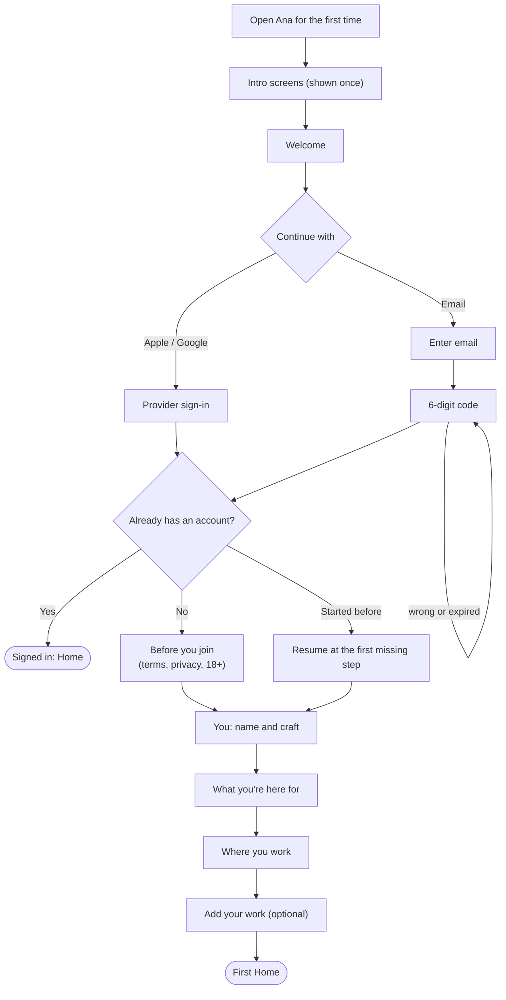
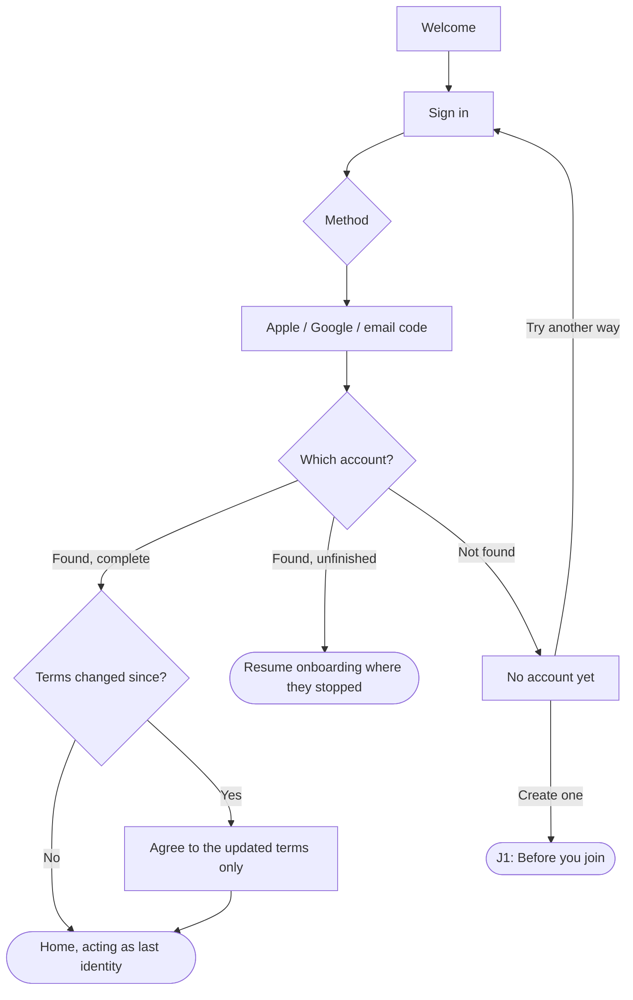
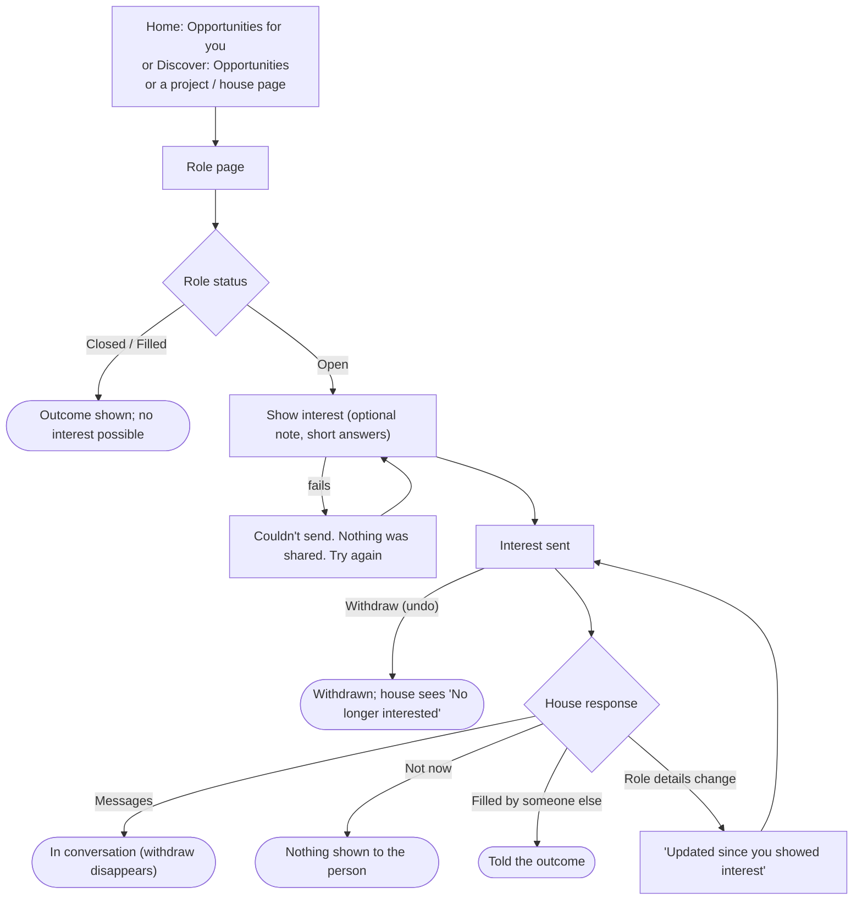
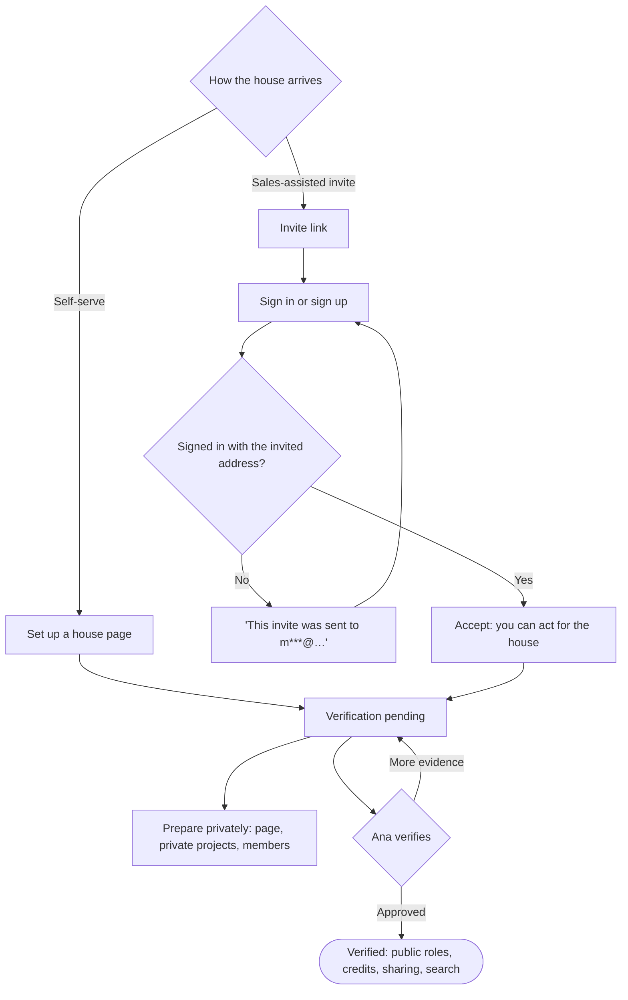
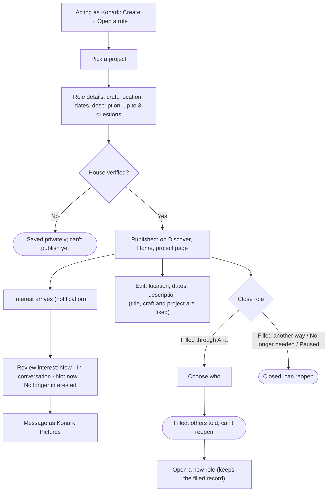
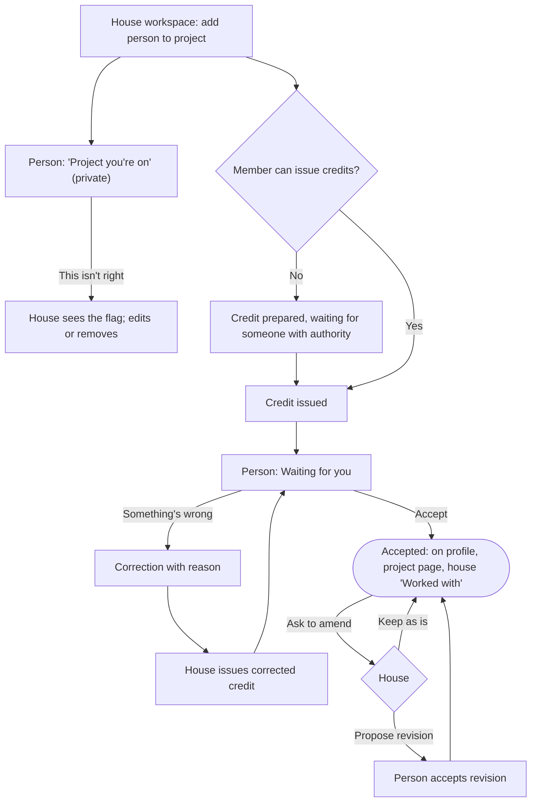
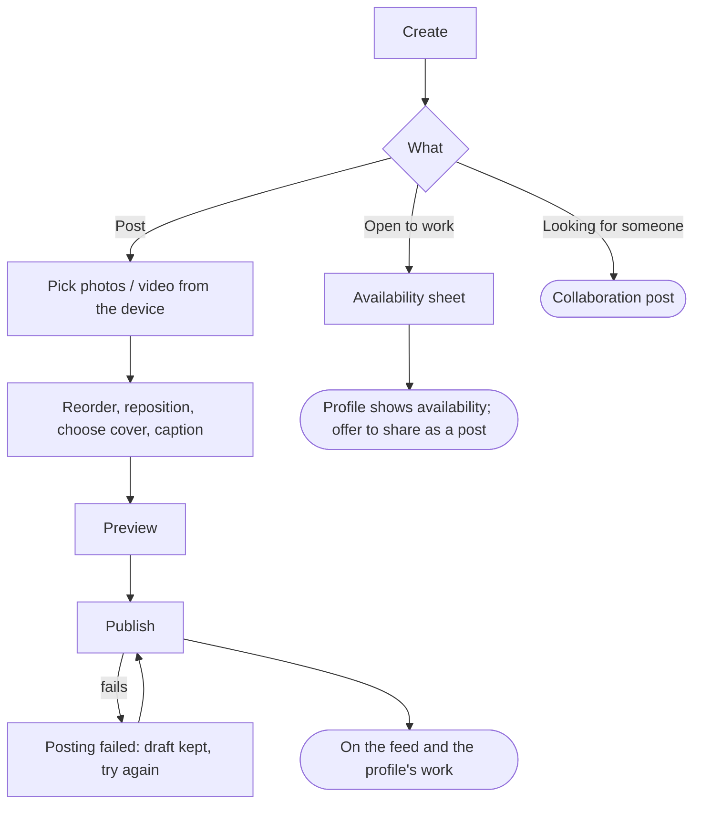
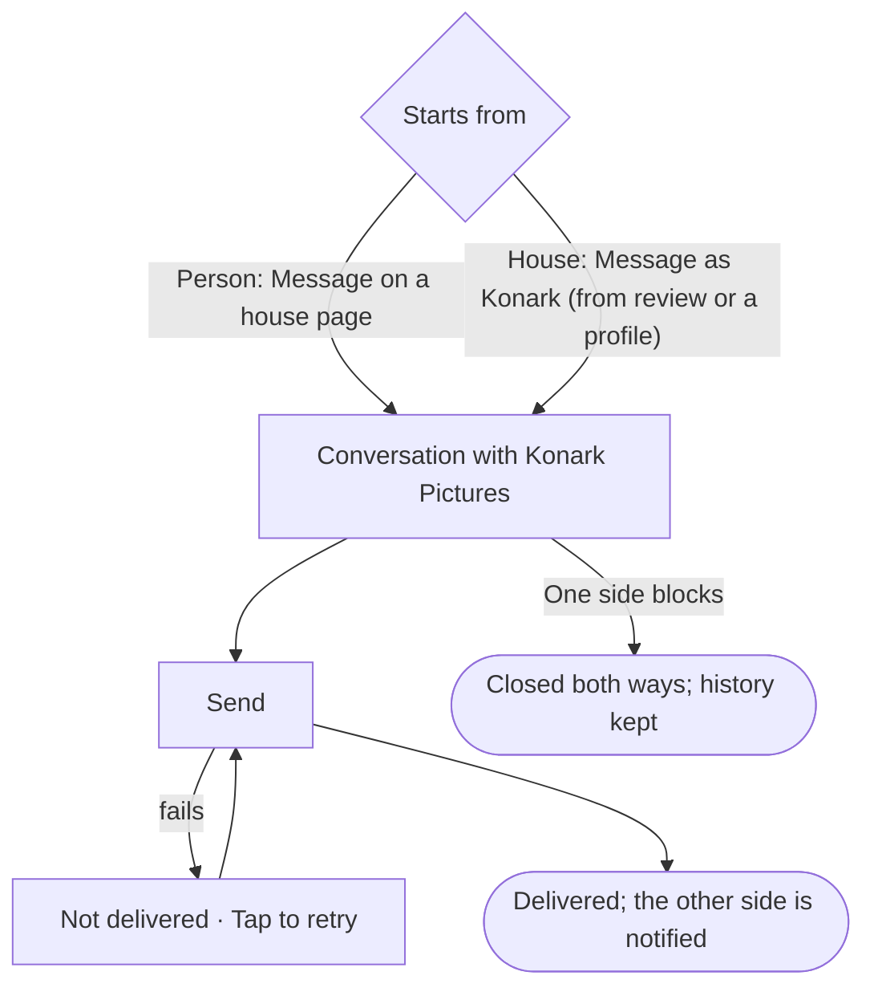
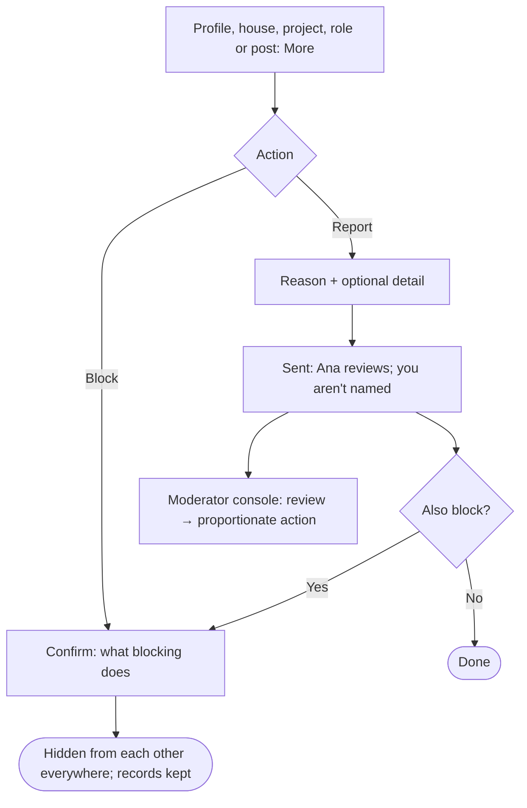

# 4. Journeys

The core v1 journeys, step by step, with their main branches drawn in. Under each one: the edge cases already catalogued for it in `docs/EDGE_CASE_MATRIX.md` (520 in total, re-run on 9 October 2026).

How to read the diagrams: rectangles are screens or steps, diamonds are decisions, and rounded boxes are where the journey ends.

---

## J1. A new person joins

- Back always returns one step and never re-enters a code screen. A refresh keeps your place.
- An invite link skips the intro and adds an optional phone step.
- **Edge cases:** Authentication (20), Account linking (8), Age and eligibility (9), Individual onboarding (20), Terms and consent (12).

## J2. A returning person signs in

- Accounts are matched only by the provider's ID or the verified email, never by name. Different sign-in methods are never merged automatically.
- **Edge cases:** Authentication (20), Account linking (8). 5 need a product decision (see document 7, theme 1).

## J3. A person finds work and shows interest

- Interest is your live profile plus an optional note. Nothing to edit; withdraw and send again to change the note.
- **Edge cases:** Roles and opportunities (25), Interest (17), Search and discovery (18).

## J4. A production house gets onto Ana

- Until verified, a house has no public label; it just can't publish.
- **Edge cases:** Production house onboarding (6), Production house verification (18). 7 need a product decision (verification evidence, revocation).

## J5. A house hires: publish a role and review interest

- No applicant tracking: no stages, shortlists or rejections.
- **Edge cases:** Roles and opportunities (25), Interest (17), Identity switching (18).

## J6. Team and credits: from added to a verified credit

- Nothing is public until the person accepts. An accepted credit can never be deleted, only amended with the person's agreement.
- If the project is private, accepted credits show only once the house shares it.
- **Edge cases:** Added to a project (20), Credits (41), People not yet on Ana (18), Independent projects (14). 32 need a product decision.

## J7. A person posts work or says they're available

- Tall images are never cropped. Posting as a house never adds to anyone's personal portfolio.
- **Edge cases:** Media and portfolio (14), Profile (14), Network and failure (14).

## J8. Messaging between a person and a house

- Members reply as the house and the composer says "Replying as Konark Pictures". A member acting as themselves can't reply as the house.
- **Edge cases:** Messaging (17), Notifications (17), Identity switching (18).

## J9. Staying safe: report and block

- Blocking is personal, even while acting for a house. Undo it from Settings or the blocked profile.
- **Edge cases:** Report and Block (23), Moderation (24).

---

## Also in the prototype (proposed for v1.1)

- **Events:** create a free event, request to attend, capacity, reminders.
- **Film reviews:** rate and review released films.

## Edge cases not tied to one journey

Account deletion (18) · Privacy and data rights (6) · Organisation closure (13) · Project privacy (13), publication (5) and lifecycle (12) · Data integrity (8) · Concurrency (12) · Accessibility (12) · Follow and Save (9) · Fine arts future-proofing (11).

**For approval:** each journey's main path and branches. Changes agreed on Sunday will be redrawn here after they're made in the prototype.
