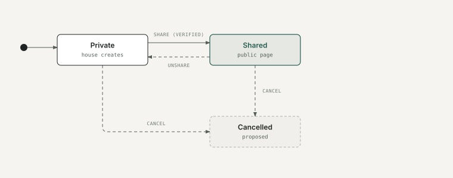
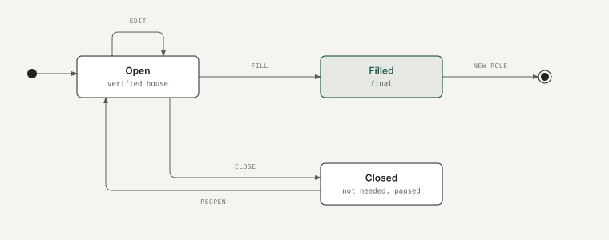
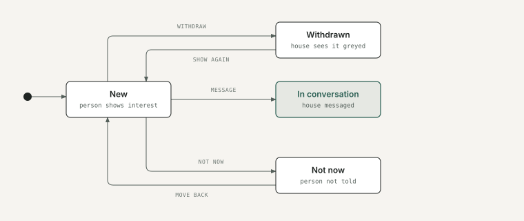
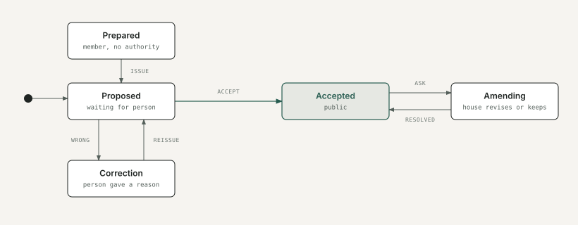
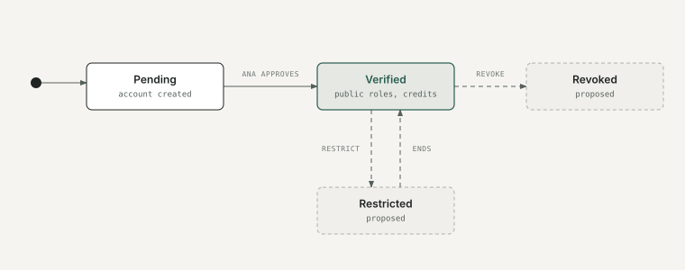
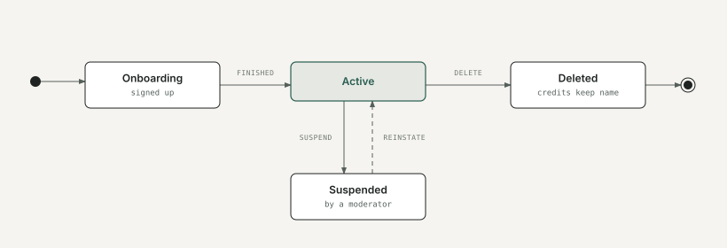

# 5. Lifecycles

The states each key object moves through, and what moves it. These are the rules developers will enforce on the server.

Each diagram shows what the prototype does today. Steps marked **(proposed)** come from the edge-case catalogue and aren't built yet; they need approval (document 7).

## Project

Stages shown on the page (development, pre-production, production, post-production, released) are information, not states. A public project in post-production or released needs a trailer or teaser.

## Role

## Interest

Interest is never deleted. The person is never told "Not now".

## Credit

Only Accepted credits are public. An accepted credit can't be deleted by anyone, including Ana moderators.

## House verification

A house account is created by Art and Artist's team after the sales visit. Whether it starts Verified (documents checked during the visit) or Pending is open (brief item B11). In the prototype, verification is a placeholder: a house is either Pending or Verified, and nothing moves it between them inside the app. Revoked (proposed): new public roles and credits stop, open roles close with a neutral reason, accepted credits stay on the films.

## Person account

Deleted: the profile goes; accepted credits stay on the film as the person's name with no link (legal review pending). Suspended (proposed detail): the profile is hidden; credits stay on films as plain names.

**For approval:** these states and transitions, especially the credit and role rules, which are hard to change after launch.
