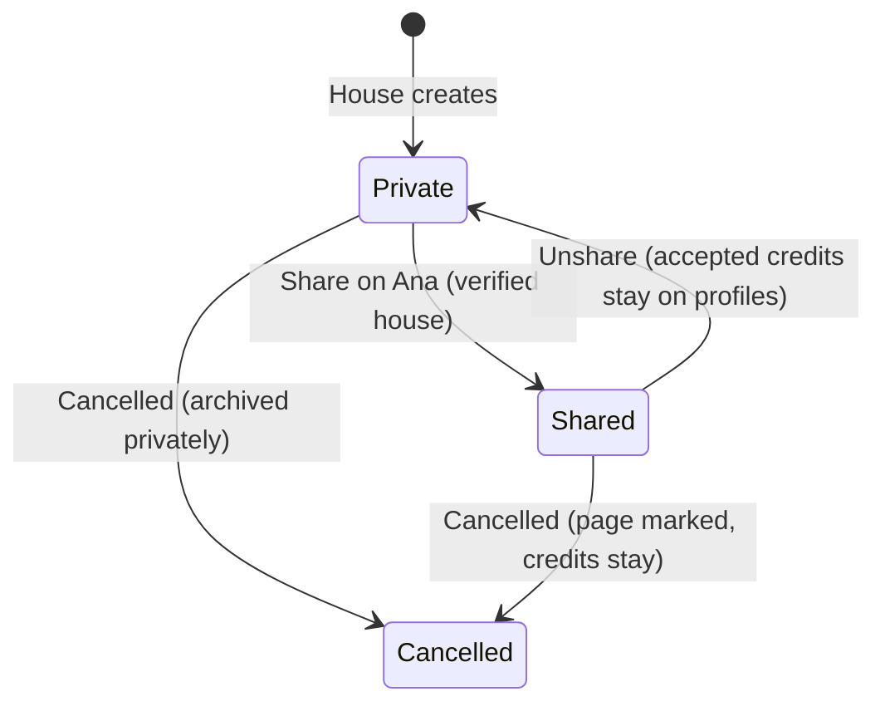
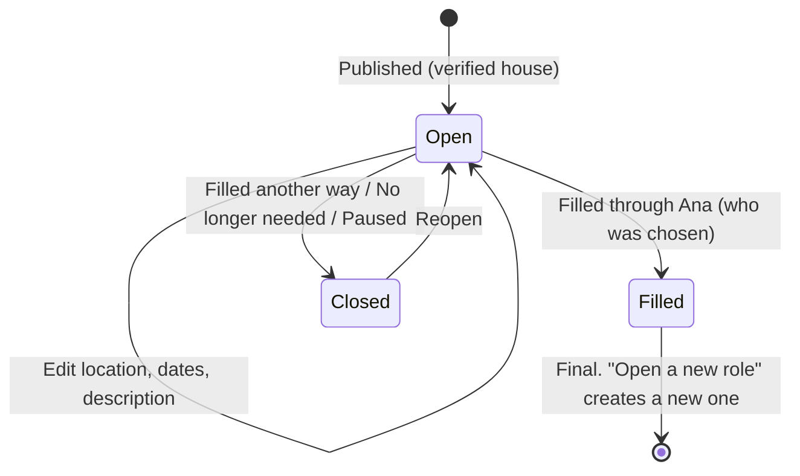
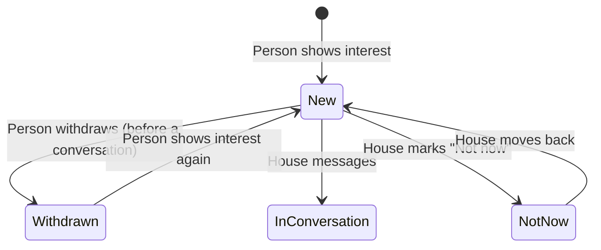
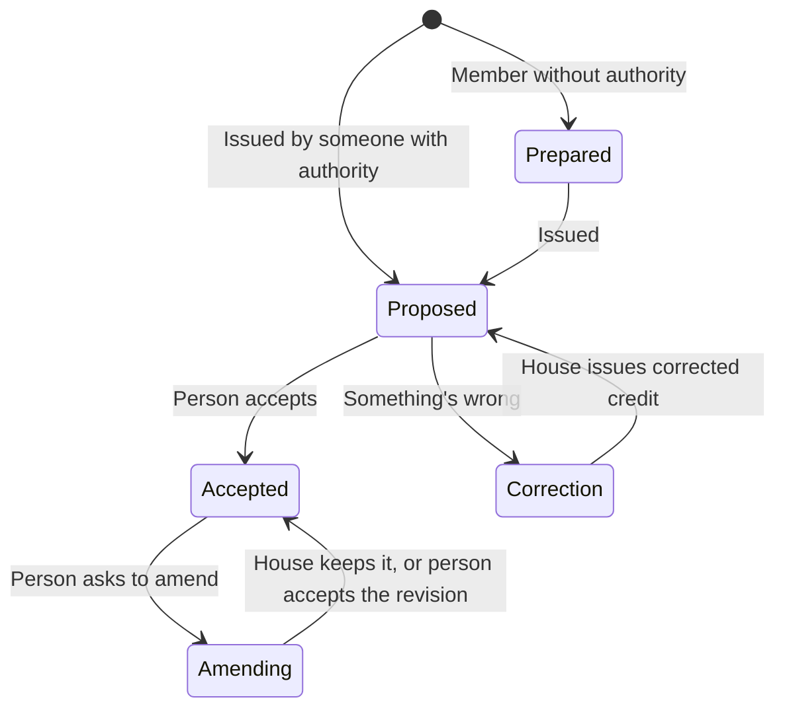
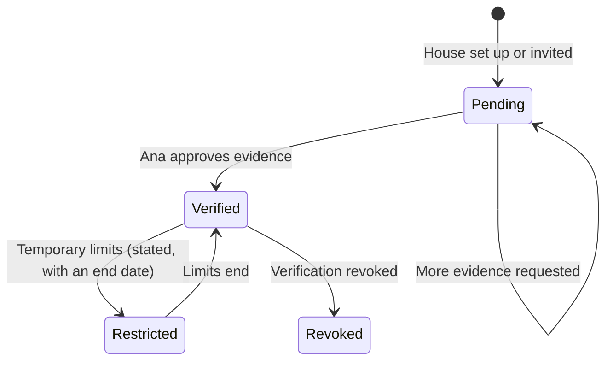
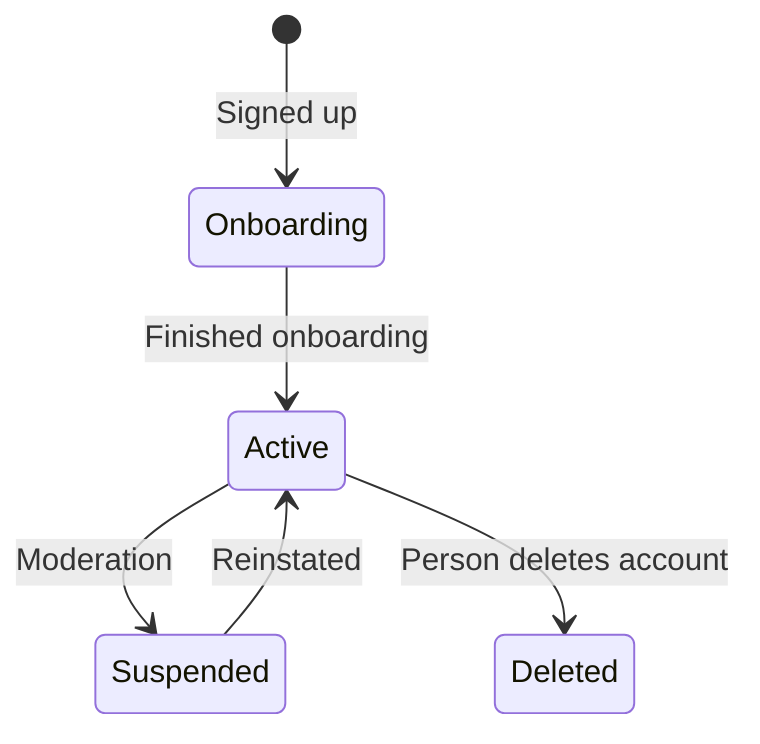

# 5. Lifecycles

The states each key object moves through, and what moves it. These are the rules developers will enforce on the server.

## Project

Stages shown on the page (development, pre-production, production, post-production, released) are information, not states. A public project in post-production or released needs a trailer or teaser.

## Role

## Interest

Interest is never deleted. The person is never told "Not now".

## Credit

Only Accepted credits are public. An accepted credit can't be deleted by anyone, including Ana moderators.

## House verification

Revoked: new public roles and credits stop, open roles close with a neutral reason, accepted credits stay on the films. (Proposed in the edge-case catalogue; needs approval, see document 7.)

## Person account

Deleted: the profile goes; accepted credits stay on the film as the person's name with no link (legal review pending). Suspended: the profile is hidden; credits stay on films as plain names.

**For approval:** these states and transitions, especially the credit and role rules, which are hard to change after launch.
